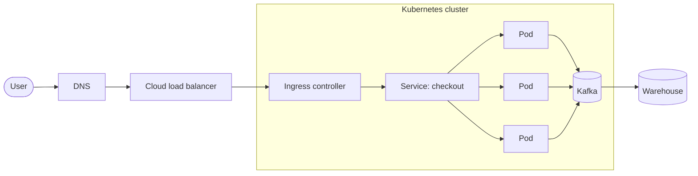

# Cluster Architecture

How a request travels from the internet to a pod, and what keeps the cluster healthy.

## Request path



## Control plane

```d2
direction: right
control-plane: Control plane {
  api: API server
  etcd: etcd {shape: cylinder}
  sched: Scheduler
  cm: Controller manager
  api -> etcd: state
  sched -> api: watch
  cm -> api: reconcile
}
node: Worker node {
  kubelet
  runtime: containerd
  kubelet -> runtime
}
node.kubelet -> control-plane.api: heartbeat
```

## Capacity at a glance

| Node pool | Instance | Nodes | vCPU | Memory |
| :-- | :-- | --: | --: | --: |
| `general` | m7g.xlarge | 12 | 48 | 192 GiB |
| `kafka` | i4i.2xlarge | 6 | 48 | 384 GiB |
| `batch` | c7g.4xlarge | 0–20 | 0–320 | 0–640 GiB |

> [!TIP]
> Keep Kafka brokers on their own node pool with local NVMe, and spread them across zones with a topology spread constraint.
