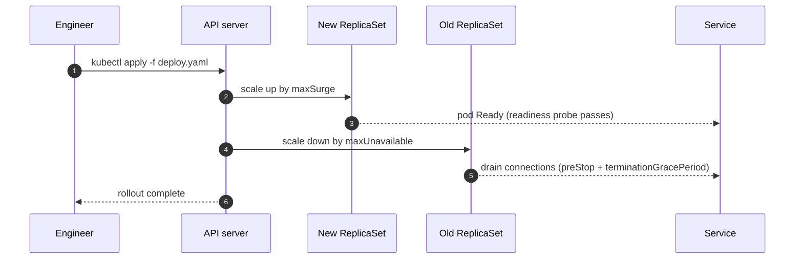

# Zero-downtime Deploys on Kubernetes

A runbook for rolling out a new version of a stateless service without dropping a single request.

> [!IMPORTANT]
> Every service must expose a **readiness probe** before it can use this runbook. Without one, Kubernetes sends traffic to pods that are still starting.

## How a rolling update works



## The deployment

```yaml
apiVersion: apps/v1
kind: Deployment
metadata:
  name: checkout
spec:
  replicas: 6
  strategy:
    type: RollingUpdate
    rollingUpdate:
      maxSurge: 25%
      maxUnavailable: 0
  template:
    spec:
      terminationGracePeriodSeconds: 45
      containers:
        - name: checkout
          image: registry.example.com/checkout:2.14.0
          readinessProbe:
            httpGet: { path: /healthz/ready, port: 8080 }
            periodSeconds: 5
          lifecycle:
            preStop:
              exec: { command: ["sleep", "15"] }
```

## Settings that matter

| Setting | Value | Why |
| :-- | --: | :-- |
| `maxUnavailable` | 0 | Never drop below full capacity |
| `maxSurge` | 25% | Roll in batches, not all at once |
| `preStop` sleep | 15 s | Let the load balancer stop routing first |
| `terminationGracePeriodSeconds` | 45 s | Finish in-flight requests |

## Rollout checklist

- [x] Readiness probe returns `503` until warm caches load
- [x] `PodDisruptionBudget` with `minAvailable: 80%`
- [ ] Dashboards: p99 latency, 5xx rate, saturation
- [ ] Rollback command ready in the incident channel

```bash
# Watch the rollout, and roll back if the error budget burns
kubectl rollout status deploy/checkout --timeout=10m
kubectl rollout undo deploy/checkout
```

> [!WARNING]
> `kubectl rollout undo` restores the previous ReplicaSet, not the previous ConfigMap. Version your config alongside the image.
