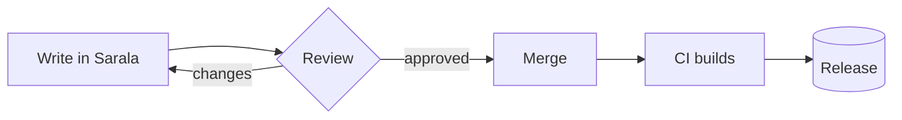

# Welcome to Sarala

Sarala renders Markdown **as you type**. There is no preview pane: the page you write *is* the page you read. Click any paragraph to see its source, and click away to see it rendered again.

> [!TIP]
> Press <kbd>⌘</kbd> <kbd>K</kbd> for the command palette, or type `/` on an empty line to insert a table, a diagram, an equation or a callout.

## Everything in one plain-text file

| Feature | You type | You see |
| :-- | :-- | :-- |
| Emphasis | `**bold**`, `*italic*`, `==highlight==` | **bold**, *italic*, ==highlight== |
| Code | `` `inline` `` and fenced blocks | Syntax-highlighted code |
| Math | `$E = mc^2$` | $E = mc^2$ |
| Diagrams | ` ```mermaid ` or ` ```d2 ` | Live, themed diagrams |
| Tasks | `- [ ] ship it` | Clickable checkboxes |

## This week

- [x] Draft the Kafka migration plan
- [x] Review the Kubernetes rollout runbook
- [ ] Load-test the new consumer group :rocket:
- [ ] Write the post-mortem template

## How a change ships



## A little math

The expected time in an M/M/1 queue, by Little's law:

$$
W = \frac{L}{\lambda} = \frac{1}{\mu - \lambda}
$$

## Code that reads like code

```typescript
export async function publish(topic: string, events: Event[]) {
  const producer = kafka.producer({ idempotent: true });
  await producer.connect();
  await producer.send({ topic, messages: events.map(toMessage) });
}
```

> [!NOTE]
> Your files stay plain Markdown on disk. Open them in any editor, diff them in Git, publish them anywhere.[^1]

[^1]: Sarala never adds hidden metadata to your documents.
